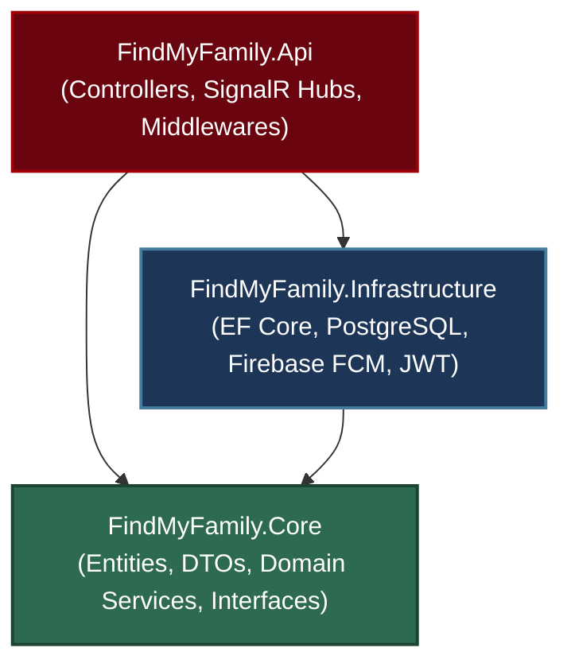
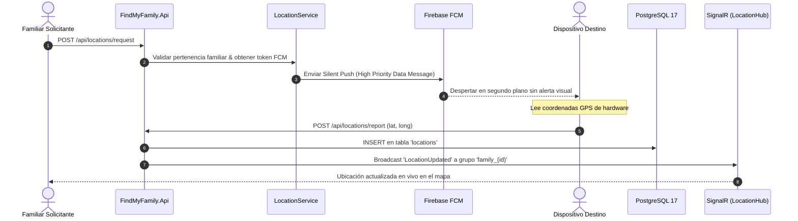

# 🛰️ FindMyFamily — Backend Core Engine

<div align="center">


<p align="center">
  <b>Motor backend de alta concurrencia para localización familiar reactiva bajo demanda (On-Demand Geolocation).</b>
  <br />
  <i>Optimizado para cero consumo innecesario de batería, baja latencia y estricta privacidad de datos.</i>
</p>

</div>

---

## 💡 El Problema y la Solución de Ingeniería

- **El Problema:** Las aplicaciones comerciales de rastreo (e.g., Life360) realizan streaming GPS continuo en segundo plano, agotando la batería del móvil en pocas horas y almacenando historiales masivos e intrusivos de trayectorias.
- **La Solución:** Una arquitectura reactiva **On-Demand**. El dispositivo objetivo permanece en reposo profundo. Cuando un familiar consulta el mapa, el backend despacha un **Silent Push (FCM Data Message prioritario)** que despierta en milisegundos el servicio en segundo plano del teléfono sin alertas visuales, captura las coordenadas GPS y las retransmite en vivo a la familia mediante **SignalR (WebSockets)** y persistencia en **PostgreSQL 17**.

---

## 🛠️ Stack Tecnológico

| Componente | Tecnología | Versión | Rol en el Sistema |
| :--- | :--- | :--- | :--- |
| **Runtime & SDK** | [.NET](https://dotnet.microsoft.com/) / [C#](https://learn.microsoft.com/dotnet/csharp/) | `10.0` / `13.0` | Plataforma de ejecución de alto rendimiento y concurrencia asíncrona pura |
| **Framework Web** | [ASP.NET Core](https://learn.microsoft.com/aspnet/core/) | `10.0` | API RESTful y gateway de WebSockets de ultra baja latencia |
| **ORM & Driver** | [EF Core](https://learn.microsoft.com/ef/core/) / [Npgsql](https://www.npgsql.org/) | `10.0` / `10.0` | Code-First, Fluent API, Migraciones y Unit of Work |
| **Base de Datos** | [PostgreSQL](https://www.postgresql.org/) | `17.x` | Motor relacional con índices compuestos para series temporales geoespaciales |
| **Tiempo Real** | [ASP.NET Core SignalR](https://learn.microsoft.com/aspnet/core/signalr) | `10.0` | Difusión de eventos por grupos pub/sub (`family_{id}` y `user_{id}`) |
| **Cloud Messaging**| [Firebase Admin SDK](https://firebase.google.com/docs/admin/setup) | `3.7.0` | Silent Push Notifications para despertar dispositivos móviles en reposo |
| **Seguridad & Auth**| [JWT](https://jwt.io/) + [BCrypt](https://github.com/BcryptNet/bcrypt.net-next) | Standard | Tokens de acceso (REST + WebSockets) y Refresh Tokens rotativos por dispositivo |
| **Infraestructura**| [Docker Compose](https://www.docker.com/) | v2 | Aprovisionamiento local reproducible de PostgreSQL 17 |

---

## 🏛️ Arquitectura del Sistema (Clean Architecture)

El proyecto desacopla estrictamente las reglas de negocio de los detalles de infraestructura mediante **Clean Architecture**:



- **`FindMyFamily.Core` (Dominio y Aplicación):** Entidades puras (`User`, `Device`, `Family`, `Location`), contratos (`IRepository`, `IPushNotificationService`), DTOs y casos de uso. Cero dependencias externas.
- **`FindMyFamily.Infrastructure` (Adaptadores):** `ApplicationDbContext`, configuraciones Fluent API, migraciones, persistencia en PostgreSQL, generador de JWT y cliente de Firebase Admin FCM.
- **`FindMyFamily.Api` (Entrada):** Controladores REST, `LocationHub` de SignalR, middleware global de excepciones y autenticación JWT con soporte de Query String para WebSockets (`?access_token=...`).

---

## ⚡ Flujo de Localización On-Demand



---

## 🗄️ Modelo de Datos y Seguridad

### Esquema Relacional (PostgreSQL 17)
- **`users`**: Identidad principal basada en número telefónico único y hash BCrypt.
- **`devices`**: Múltiples dispositivos por usuario, token FCM y Refresh Token rotativo con expiración a 90 días.
- **`families` & `family_members`**: Agrupación familiar con clave compuesta `(family_id, user_id)`.
- **`locations`**: Registro de coordenadas con precisión `decimal(10, 8)` / `decimal(11, 8)` e índice compuesto `(user_id, captured_at)` para consultas de historial ultrarrápidas ($O(\log n)$).

### Matriz RBAC Dual
- **Nivel Sistema:** `admin` (Superadministrador con control global de la plataforma) y `member` (Usuario estándar).
- **Nivel Familia:** `admin` (Gestor del círculo familiar: invita, cambia roles o expulsa) y `member` (Miembro con permisos de consulta y reporte dentro de su grupo).

---

## 📡 Endpoints Principales

| Módulo | Método | Endpoint | Acceso | Descripción |
| :--- | :---: | :--- | :---: | :--- |
| **Auth** | `POST` | `/api/auth/login` | Público | Login con teléfono/contraseña; registra dispositivo y emite tokens |
| **Auth** | `POST` | `/api/auth/refresh-token` | Público | Renovación de tokens mediante Refresh Token |
| **Perfil** | `GET` | `/api/users/me` | Autenticado | Perfil del usuario, rol global y familias asociadas |
| **Admin** | `POST` | `/api/users` | `admin` (Global) | Alta de usuario con asignación obligatoria a familia |
| **Familias** | `GET` | `/api/families` | Autenticado | Familias del usuario (o todas si es Super Admin) |
| **Familias** | `POST` | `/api/families/{id}/members` | Admin Familiar | Da de alta e incorpora un pariente a la familia |
| **Devices** | `PATCH` | `/api/devices/fcm-token` | Autenticado | Actualización del token FCM tras rotaciones del SO |
| **Locations** | `POST` | `/api/locations/request` | Miembro Familiar | Despacha el Silent Push FCM al dispositivo del familiar |
| **Locations** | `POST` | `/api/locations/report` | Autenticado | Reporte de coordenadas GPS tras despertar en background |
| **Locations** | `GET` | `/api/locations/families/{fId}/users/{uId}/latest` | Miembro Familiar | Consulta de última posición geográfica conocida |
| **Realtime** | `WS` | `/hubs/location` | JWT Bearer | Hub SignalR con salas automáticas `family_{id}` y `user_{id}` |

> 💡 Incluye suite completa de pruebas ejecutables en [`FindMyFamily.Api.http`](file:///Users/kencrisg/Development/Projects/personal/FindMyFamily/FindMyFamily.Backend/FindMyFamily.Api/FindMyFamily.Api.http) y Swagger interactivo en `/swagger`.

---

## 🚀 Inicio Rápido Local

```bash
# 1. Levantar PostgreSQL 17 con Docker
docker compose up -d postgres

# 2. Configurar variables de entorno (.env)
cd FindMyFamily.Backend
cp .env.example .env

# 3. Aplicar migraciones de Entity Framework Core
dotnet ef database update --project FindMyFamily.Infrastructure --startup-project FindMyFamily.Api

# 4. Ejecutar la API
dotnet run --project FindMyFamily.Api
```

- **Swagger UI:** `http://localhost:5210/swagger`
- **SignalR Hub:** `http://localhost:5210/hubs/location`

> *Modo Desarrollo:* Si no se especifica un archivo `firebase-admin.json` válido, el backend activa automáticamente el modo simulado (`DEV-MOCK`) para permitir pruebas completas de integración sin credenciales de Google.

---

## 📂 Estructura del Proyecto

```
FindMyFamily.Backend/
├── FindMyFamily.Api/            # REST Controllers, SignalR Hubs, Middlewares, Program.cs
├── FindMyFamily.Core/           # Entidades, DTOs, Interfaces, Lógica de Negocio Pura
├── FindMyFamily.Infrastructure/ # EF Core DbContext, Repositorios, PostgreSQL, Firebase FCM, JWT
├── docs/                        # Diagramas de arquitectura, base de datos y secuencias
├── FindMyFamily.Api.http        # Suite de pruebas HTTP para VS Code / Visual Studio
├── docker-compose.yml           # Contenedor de PostgreSQL 17
└── README.md                    # Documentación técnica
```

---

## 👨‍💻 Autor y Licencia

Desarrollado por **kencrisgdev** — Proyecto publicado bajo Licencia [MIT](LICENSE).
