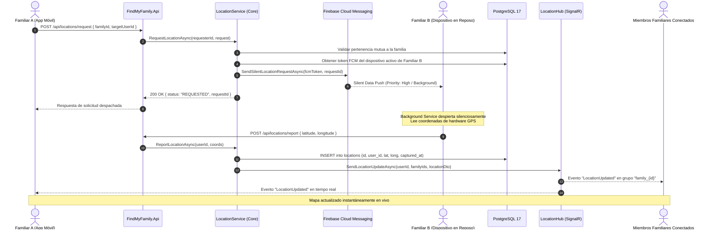

# 🛰️ FindMyFamily — Backend Core Engine

<div align="center">


<p align="center">
  <b>Motor backend de alta concurrencia y telemetría familiar reactiva bajo demanda (On-Demand Geolocation).</b>
  <br />
  <i>Diseñado para resolver el monitoreo familiar en tiempo real con cero drenaje de batería y estricta privacidad de datos.</i>
</p>

[Características](#-características-principales) •
[Arquitectura](#-arquitectura-del-sistema-clean-architecture) •
[Flujo On-Demand](#-flujo-de-localización-on-demand) •
[Modelo de Datos](#-modelo-de-datos-y-persistencia) •
[Seguridad y RBAC](#-seguridad-autenticación-y-rbac) •
[Endpoints](#-catálogo-de-endpoints-api) •
[Puesta en Marcha](#-guía-de-instalación-y-despliegue-local)

---

</div>

## 📌 Contexto del Proyecto: El Problema Real y la Solución de Ingeniería

### El Problema
Las aplicaciones comerciales de localización familiar convencionales (como Life360 o Google Maps Compartir Ubicación) presentan dos problemas críticos de ingeniería y experiencia de usuario:
1. **Drenaje severo de batería:** Transmiten coordenadas GPS de manera continua e indiscriminada en segundo plano, manteniendo despiertos los sensores de radiofrecuencia y agotando la batería del dispositivo.
2. **Privacidad comprometida y datos centralizados:** La recolección ininterrumpida de trayectorias crea historiales exhaustivos de hábitos personales alojados en infraestructuras de terceros.

### La Solución de Ingeniería
**FindMyFamily Backend** implementa un modelo de localización reactivo **Bajo Demanda (On-Demand)**:
- Los dispositivos móviles permanecen en **modo de reposo profundo (deep sleep)** sin reportar telemetría ni consumir batería.
- Cuando un familiar autorizado requiere la ubicación de un ser querido, el backend despacha un **Silent Push Notification (FCM Data Message prioritario)** que despierta exclusivamente el servicio en segundo plano del teléfono sin alertas visuales ni ruidos.
- El dispositivo captura la coordenada GPS en milisegundos y la reporta al backend mediante REST.
- El backend almacena la coordenada en **PostgreSQL** y la transmite instantáneamente a toda la familia a través de **SignalR (WebSockets)** con latencia sub-segundo.

---

## 🚀 Características Principales

- **Arquitectura Limpia (Clean Architecture / Onion):** Separación estricta de responsabilidades en capas (`Core`, `Infrastructure`, `Api`) con inversión de dependencias y cero acoplamiento tecnológico en la lógica de negocio.
- **Despertar Remoto mediante Silent Push:** Integración nativa con **Firebase Admin SDK** para enviar mensajes de datos de alta prioridad (`AndroidConfig.Priority = High` y `APNs background push`), capaces de despertar tareas en segundo plano en Android e iOS.
- **Transmisión Bidireccional en Tiempo Real:** Utiliza **ASP.NET Core SignalR** para la difusión inmediata de coordenadas hacia grupos familiares (`family_{id}`) y canales personales (`user_{id}`).
- **Autenticación Robusta y Sesiones Persistentes:**
  - Identidad basada en número telefónico móvil validado con hash **BCrypt**.
  - Emisión de tokens criptográficos **JWT (JSON Web Tokens)** con soporte para handshake sobre WebSockets mediante Query Strings (`?access_token=...`).
  - Esquema de rotación de **Refresh Tokens** persistidos por dispositivo físico (`Device`), permitiendo sesiones seguras y duraderas (90 días).
- **Control de Acceso Multi-Inquilino (RBAC Dual-Layer):**
  - **Nivel Sistema:** `admin` (Superadministrador con control global) y `member`.
  - **Nivel Familia:** `admin` (Gestor del círculo familiar) y `member` (Miembro con permisos de consulta y reporte).
  - Aislamiento estricto de datos: ningún usuario puede solicitar ni consultar la ubicación de otra persona salvo que compartan activamente el mismo grupo familiar.
- **Persistencia y Modelado Espacial Optimizado:**
  - **Entity Framework Core 10** sobre **PostgreSQL 17** vía **Npgsql**.
  - Almacenamiento de coordenadas con precisión geográfica `decimal(10, 8)` y `decimal(11, 8)`.
  - Índices compuestos `(user_id, captured_at)` diseñados para consultas de series temporales de alta velocidad.
- **Manejo Centralizado de Excepciones:** Middleware global que intercepta excepciones de dominio tipadas (`NotFoundException`, `ForbiddenException`, `ConflictException`, etc.) y responde con esquemas estandarizados RFC 7807.
- **Documentación Dinámica con OpenAPI / Swagger:** Filtro personalizado `AuthorizeCheckOperationFilter` que añade automáticamente el candado de seguridad y esquemas Bearer únicamente a endpoints decorados con `[Authorize]`.

---

## 🛠️ Stack Tecnológico

| Capa / Función | Tecnología | Versión | Descripción / Propósito |
| :--- | :--- | :--- | :--- |
| **Runtime & SDK** | [.NET](https://dotnet.microsoft.com/) | `10.0.402` (net10.0) | Plataforma de ejecución de alto rendimiento con optimizaciones JIT de última generación |
| **Lenguaje** | [C#](https://learn.microsoft.com/dotnet/csharp/) | `13.0` | Tipado estático fuerte, records inmutables, pattern matching y concurrencia asíncrona pura |
| **Framework Web** | [ASP.NET Core](https://learn.microsoft.com/aspnet/core/) | `10.0` | API RESTful y microservidor de WebSockets de ultra baja latencia |
| **ORM & Data Mapping** | [Entity Framework Core](https://learn.microsoft.com/ef/core/) | `10.0.12` | Code-First, Fluent API Configurations, Migraciones automatizadas y Unit of Work |
| **Motor de Base de Datos**| [PostgreSQL](https://www.postgresql.org/) | `17.x` | Base de datos relacional ACID optimizada para persistencia de telemetría geoespacial |
| **PostgreSQL Provider** | [Npgsql.EntityFrameworkCore](https://www.npgsql.org/) | `10.0.3` | Driver de conexión nativa de alto rendimiento para PostgreSQL en EF Core |
| **Comunicación Realtime** | [ASP.NET Core SignalR](https://learn.microsoft.com/aspnet/core/signalr) | `10.0` | Abstracción de WebSockets con fallback automático y distribución por grupos pub/sub |
| **Cloud Messaging (Push)**| [Firebase Admin SDK](https://firebase.google.com/docs/admin/setup) | `3.7.0` | Despacho de Silent Push Data Messages para despertar dispositivos móviles en reposo |
| **Criptografía & Auth** | [BCrypt.Net-Next](https://github.com/BcryptNet/bcrypt.net-next) | `4.2.0` | Algoritmo adaptativo de hashing de contraseñas con salt criptográfico automático |
| **Tokens de Seguridad** | [System.IdentityModel.Tokens.Jwt](https://github.com/AzureAD/azure-activedirectory-identitymodel-extensions-for-dotnet) | `8.23.0` | Generación y validación de tokens de acceso criptográficos HMAC-SHA256 |
| **Variables de Entorno** | [DotNetEnv](https://github.com/tonerdo/dotnet-env) | `3.2.0` | Carga declarativa de configuración conforme al estándar de 12-Factor App |
| **OpenAPI / Swagger** | [Swashbuckle.AspNetCore](https://github.com/domaindrivendev/Swashbuckle.AspNetCore) | `10.2.3` | Generación interactiva de documentación y pruebas con soporte JWT integrado |
| **Contenedores** | [Docker & Docker Compose](https://www.docker.com/) | v2 / Compose v2 | Orquestación del entorno de datos PostgreSQL local aislado y reproducible |

---

## 🏛️ Arquitectura del Sistema (Clean Architecture)

El proyecto sigue rigurosamente los principios de **Clean Architecture (Onion Architecture)** y los principios **SOLID**, garantizando que el núcleo de negocio sea independiente de frameworks externos, bases de datos o clientes móviles:

```
FindMyFamily.Backend/
├── FindMyFamily.Core/            <- Núcleo de Dominio & Aplicación (Zero Dependencies)
│   ├── Entities/                 <- Modelos de dominio puros (User, Device, Family, etc.)
│   ├── DTOs/                     <- Contratos de entrada y salida (Data Transfer Objects)
│   ├── Exceptions/               <- Jerarquía de excepciones de dominio (AppException, NotFound, etc.)
│   ├── Interfaces/
│   │   ├── Repositories/         <- Contratos de persistencia (IUserRepository, IUnitOfWork, etc.)
│   │   └── Services/             <- Contratos de servicios de aplicación y conectores
│   └── Services/                 <- Casos de uso y reglas de negocio puras
│
├── FindMyFamily.Infrastructure/  <- Adaptadores de Persistencia & Servicios Externos
│   ├── Persistence/
│   │   ├── ApplicationDbContext  <- DbContext de Entity Framework Core
│   │   ├── Configurations/       <- Fluent API Mappings por entidad
│   │   ├── Migrations/           <- Historial evolutivo de esquema en PostgreSQL
│   │   └── Repositories/         <- Implementación de IRepositories con LINQ y EF Core
│   ├── Security/
│   │   ├── BCryptPasswordHasher  <- Hasheo y verificación de credenciales
│   │   └── JwtTokenGenerator     <- Generación de Claims y Access/Refresh Tokens
│   └── Services/
│       └── FirebasePushNotificationService <- Adaptador de Firebase Cloud Messaging (FCM)
│
└── FindMyFamily.Api/             <- Capa de Presentación, Gateway REST & Real-Time
    ├── Controllers/              <- Controladores REST (Auth, Users, Families, Devices, Locations)
    ├── Hubs/                     <- LocationHub (SignalR WebSockets Endpoint)
    ├── Middlewares/              <- ExceptionHandlingMiddleware centralizado
    ├── Filters/                  <- AuthorizeCheckOperationFilter (Swagger Security)
    └── Services/                 <- SignalRLocationNotifier (Implementación de ILocationRealtimeNotifier)
```

### Relación de Dependencias

```mermaid
graph TD
    API[FindMyFamily.Api\n(Controllers, Hubs, Middlewares)] --> CORE[FindMyFamily.Core\n(Entities, DTOs, Business Logic, Interfaces)]
    INFRA[FindMyFamily.Infrastructure\n(PostgreSQL, EF Core, Firebase, JWT)] --> CORE
    API --> INFRA

    style CORE fill:#2d6a4f,stroke:#1b4332,stroke-width:2px,color:#fff
    style INFRA fill:#1d3557,stroke:#457b9d,stroke-width:2px,color:#fff
    style API fill:#6a040f,stroke:#9d0208,stroke-width:2px,color:#fff
```

> **Regla de Inversión de Dependencias (DIP):** `FindMyFamily.Core` no contiene referencias a paquetes de Entity Framework, ASP.NET Core ni Firebase. Las interfaces (`IRepository`, `IPushNotificationService`, `ILocationRealtimeNotifier`) se definen en el Core y son implementadas por `Infrastructure` y `Api`.

---

## ⚡ Flujo de Localización On-Demand

El siguiente diagrama de secuencia detalla cómo interactúan los componentes cuando un familiar solicita la ubicación:



---

## 🗄️ Modelo de Datos y Persistencia

El esquema de base de datos en **PostgreSQL 17** fue diseñado para soportar consultas frecuentes de telemetría y particionamiento natural por usuario:

```
                    ┌─────────────────────────┐
                    │          users          │
                    ├─────────────────────────┤
                    │ id (PK: UUID)           │
                    │ first_name (VARCHAR)    │
                    │ last_name (VARCHAR)     │
                    │ phone_number (UQ: TEXT) │◄─────────────┐
                    │ password_hash (TEXT)    │              │
                    │ role (VARCHAR: admin/mbr)│              │
                    │ created_at (TIMESTAMP)  │              │
                    └───────────┬─────────────┘              │
                                │ 1                          │ 1
                                │                            │
        ┌───────────────────────┼───────────────────────┐    │
        │ 1..N                  │ 1..N                  │ 1..N
        ▼                       ▼                       ▼    │
┌──────────────────┐    ┌─────────────────┐    ┌─────────────────────┐
│     devices      │    │    locations    │    │   family_members    │
├──────────────────┤    ├─────────────────┤    ├─────────────────────┤
│ id (PK: UUID)    │    │ id (PK: UUID)   │    │ family_id (PK/FK)   │
│ user_id (FK)     │    │ user_id (FK)    │    │ user_id (PK/FK)     │──┘
│ fcm_token (TEXT) │    │ latitude (DEC)  │    │ role (admin/member) │
│ refresh_token    │    │ longitude (DEC) │    │ joined_at           │
│ device_model     │    │ captured_at (TS)│    └──────────┬──────────┘
│ last_active_at   │    └─────────────────┘               │ N..1
│ is_active (BOOL) │                                      ▼
└──────────────────┘                           ┌─────────────────────┐
                                               │      families       │
                                               ├─────────────────────┤
                                               │ id (PK: UUID)       │
                                               │ name (VARCHAR)      │
                                               │ created_at          │
                                               └─────────────────────┘
```

### Optimizaciones de Base de Datos y Fluent API
- **Índices Compuestos:** `builder.HasIndex(l => new { l.UserId, l.CapturedAt });` garantiza que las consultas de historial (`GET .../history?limit=20`) y última ubicación resuelvan en tiempo $O(\log n)$ sin realizar escaneos secuenciales de tabla.
- **Precisión Geoespacial:** Coordenadas mapeadas como `decimal(10, 8)` (Latitud: 8 decimales equivalen a una precisión milimétrica $< 1.1\text{ mm}$) y `decimal(11, 8)` (Longitud).
- **Mapeo Limpio de Nombres:** Nombres de tabla e identificadores en minúsculas tipo `snake_case` según las convenciones de PostgreSQL (`users`, `devices`, `families`, `family_members`, `locations`).

---

## 🔒 Seguridad, Autenticación y RBAC

### 1. Autenticación Híbrida (REST + WebSockets)
- **REST Endpoints:** La autorización estándar se realiza mediante el header `Authorization: Bearer <jwt_token>`.
- **SignalR WebSockets:** Los clientes WebSockets no siempre pueden enviar cabeceras HTTP personalizadas durante el protocolo de negociación (Handshake). El backend incluye un middleware de eventos en `JwtBearerEvents` que extrae el token directamente desde el query string:
  ```csharp
  options.Events = new JwtBearerEvents
  {
      OnMessageReceived = context =>
      {
          var accessToken = context.Request.Query["access_token"];
          var path = context.HttpContext.Request.Path;
          if (!string.IsNullOrEmpty(accessToken) && path.StartsWithSegments("/hubs"))
          {
              context.Token = accessToken;
          }
          return Task.CompletedTask;
      }
  };
  ```

### 2. Matriz de Roles (RBAC Dual)

| Nivel | Rol | Capacidades / Permisos |
| :--- | :--- | :--- |
| **Sistema** | `admin` *(Super Admin)* | Acceso total a la plataforma: consultar/crear/eliminar cualquier usuario, crear/eliminar familias arbitrarias, reasignar familiares y desvincular dispositivos globalmente. |
| **Sistema** | `member` | Usuario registrado regular. Solo puede operar dentro del contexto de las familias a las que ha sido añadido. |
| **Familia** | `admin` *(Admin Familiar)* | Propietario del núcleo familiar. Puede invitar miembros, dar de alta familiares por teléfono, reasignar roles de miembros y expulsar parientes del grupo. |
| **Familia** | `member` *(Miembro)* | Consulta la última ubicación e historial de los demás miembros de la familia y reporta su propia ubicación tras un Silent Push. |

---

## 📡 Catálogo de Endpoints API

La API expone una interfaz REST estructurada y predecible. La documentación interactiva completa está disponible en `/swagger` en entornos de desarrollo.

### Autenticación (`/api/auth`)
| Método | Endpoint | Acceso | Descripción |
| :---: | :--- | :---: | :--- |
| `POST` | `/api/auth/login` | Público | Autenticación con teléfono y password. Registra o actualiza el dispositivo físico y emite Access Token + Refresh Token. |
| `POST` | `/api/auth/refresh-token` | Público | Rota el Refresh Token existente y renueva el Access Token sin forzar re-inicio de sesión. |

### Perfil y Gestión de Usuarios (`/api/users`)
| Método | Endpoint | Acceso | Descripción |
| :---: | :--- | :---: | :--- |
| `GET` | `/api/users/me` | Autenticado | Retorna el perfil completo del usuario, su rol global y sus familias asociadas con sus roles familiares. |
| `PATCH` | `/api/users/me/phone` | Autenticado | Actualiza el teléfono de acceso (requiere validar contraseña previa). |
| `PATCH` | `/api/users/me/password` | Autenticado | Cambio seguro de contraseña validando la contraseña actual. |
| `GET` | `/api/users` | `admin` (Global) | Lista paginada de todos los usuarios registrados en el sistema. |
| `GET` | `/api/users/{id}` | `admin` (Global) | Detalle de un usuario específico por UUID. |
| `POST` | `/api/users` | `admin` (Global) | Da de alta a un usuario asignándolo directamente a una familia. |
| `PATCH` | `/api/users/{id}` | `admin` (Global) | Actualiza datos y/o reasigna de familia a un usuario. |
| `DELETE` | `/api/users/{id}` | `admin` (Global) | Baja definitiva de un usuario del sistema. |

### Círculos Familiares (`/api/families`)
| Método | Endpoint | Acceso | Descripción |
| :---: | :--- | :---: | :--- |
| `POST` | `/api/families` | `admin` (Global) | Crea un nuevo grupo familiar en el sistema. |
| `GET` | `/api/families` | Autenticado | Retorna todas las familias (si es Super Admin) o las familias del usuario. |
| `GET` | `/api/families/{id}` | Miembro de Familia | Obtiene el detalle de la familia y el listado de todos sus integrantes. |
| `PATCH` | `/api/families/{id}` | `admin` (Global) | Modifica el nombre de la familia. |
| `DELETE` | `/api/families/{id}` | `admin` (Global) | Elimina un grupo familiar en cascada. |
| `POST` | `/api/families/{id}/members` | Admin Familiar | Da de alta a un nuevo familiar registrándolo directamente en el grupo. |
| `POST` | `/api/families/{id}/members/link` | Admin Familiar | Vincula a un usuario preexistente a la familia mediante su número telefónico. |
| `PATCH` | `/api/families/{id}/members/{userId}/role` | Admin Familiar | Cambia el rol de un miembro (`admin` o `member`). |
| `DELETE` | `/api/families/{id}/members/{userId}` | Admin o Propietario | Expulsa a un miembro o abandona el grupo familiar. |

### Dispositivos Móviles (`/api/devices`)
| Método | Endpoint | Acceso | Descripción |
| :---: | :--- | :---: | :--- |
| `PATCH` | `/api/devices/fcm-token` | Autenticado | Actualiza el token FCM del dispositivo en uso tras renovaciones por parte del SO. |
| `DELETE` | `/api/devices/{id}` | Propietario / Admin | Desvincula y desactiva un dispositivo del usuario. |

### Geolocalización On-Demand (`/api/locations`)
| Método | Endpoint | Acceso | Descripción |
| :---: | :--- | :---: | :--- |
| `POST` | `/api/locations/request` | Miembro de Familia | Despacha el **Silent Push FCM** al dispositivo destino para solicitar coordenadas. |
| `POST` | `/api/locations/report` | Autenticado | El dispositivo reporta sus coordenadas GPS tras despertar. Se persiste y se emite vía SignalR. |
| `GET` | `/api/locations/families/{familyId}/users/{userId}/latest` | Miembro de Familia | Consulta la última coordenada conocida de un familiar. |
| `GET` | `/api/locations/families/{familyId}/users/{userId}/history` | Miembro de Familia | Retorna el historial cronológico reciente de ubicaciones registradas. |

### Canal en Tiempo Real (SignalR Hub)
- **Ruta de Conexión:** `/hubs/location` (Soporta `?access_token={jwt}`)
- **Grupos Autogestionados en `OnConnectedAsync`:**
  - `user_{userId}`: Notificaciones exclusivas al usuario.
  - `family_{familyId}`: Notificaciones a todos los integrantes de la familia.
- **Evento Emitido por el Servidor:** `LocationUpdated` (Payload con `LocationDto`).

---

## 💻 Guía de Instalación y Despliegue Local

### 1. Prerrequisitos
- [.NET 10.0 SDK](https://dotnet.microsoft.com/download/dotnet/10.0) instalado localmente.
- [Docker & Docker Compose](https://www.docker.com/) en ejecución.
- Herramienta CLI de EF Core (opcional para migraciones manuales):
  ```bash
  dotnet tool install --global dotnet-ef
  ```

### 2. Clonación y Configuración del Entorno
Clona el repositorio y navega a la raíz del backend:
```bash
git clone https://github.com/tu-usuario/FindMyFamily.git
cd FindMyFamily/FindMyFamily.Backend
```

Crea el archivo `.env` a partir de la plantilla de ejemplo:
```bash
cp .env.example .env
```

Configura las variables esenciales en el archivo `.env`:
```ini
ASPNETCORE_ENVIRONMENT=Development

# Base de datos local
DB_HOST=localhost
DB_PORT=5432
DB_NAME=findmyfamilydb
DB_USER=postgres
DB_PASSWORD=passwordpostgres

# Llave JWT (al menos 32 caracteres)
JWT_SECRET=super_secret_jwt_key_find_my_family_2026_at_least_32_chars_long
JWT_ISSUER=FindMyFamilyApi
JWT_AUDIENCE=FindMyFamilyApp
JWT_EXPIRY_MINUTES=60

# Firebase Cloud Messaging
FIREBASE_CREDENTIALS_PATH=./firebase-admin.json
```

> **Nota para Entornos de Desarrollo sin Firebase:** Si no dispones de un archivo `firebase-admin.json` real, el servicio `FirebasePushNotificationService` activa automáticamente un **Modo Simulado (`DEV-MOCK`)**, permitiendo probar todo el flujo de negocio y endpoints sin errores de autenticación con Google.

### 3. Levantar la Base de Datos con Docker
Desde el directorio raíz de la solución (donde reside `docker-compose.yml`):
```bash
docker compose up -d postgres
```

### 4. Aplicar Migraciones de Base de Datos
Aplica el esquema y las migraciones pendientes en PostgreSQL:
```bash
dotnet ef database update --project FindMyFamily.Infrastructure --startup-project FindMyFamily.Api
```

### 5. Compilar y Ejecutar la API
```bash
dotnet run --project FindMyFamily.Api
```

El servidor iniciará en los siguientes puertos (configurados en `launchSettings.json`):
- **HTTP:** `http://localhost:5210`
- **Swagger UI:** `http://localhost:5210/swagger`
- **SignalR Hub:** `http://localhost:5210/hubs/location`

---

## 🧪 Pruebas y Smoke Testing Integrado

El proyecto incluye una suite exhaustiva de pruebas HTTP en el archivo [`FindMyFamily.Api.http`](file:///Users/kencrisg/Development/Projects/personal/FindMyFamily/FindMyFamily.Backend/FindMyFamily.Api/FindMyFamily.Api.http), compatible de forma nativa con el **REST Client de Visual Studio / VS Code**:

1. **Smoke Tests:** Verificación del estado de salud del servidor (`GET /`).
2. **Ciclo de Autenticación:** Pruebas de Login y Refresh Token.
3. **Gestión de Perfil:** Consulta y actualización segura de número telefónico y credenciales.
4. **Flujo Administrativo:** Creación y asignación de usuarios y grupos familiares.
5. **Ciclo Completo On-Demand:** Disparo de `POST /api/locations/request`, reporte de coordenadas simuladas con `POST /api/locations/report` y lectura de telemetría reciente e histórica.

---

## 📂 Estructura de la Solución

```
FindMyFamily.Backend/
├── docs/
│   ├── architecture diagram.png      # Diagrama de arquitectura del sistema
│   ├── database_diagram.png          # Modelo relacional de entidades
│   ├── sequence diagram.png          # Secuencia del flujo On-Demand
│   └── database.txt                  # Definición del esquema en formato DBML
│
├── FindMyFamily.Api/                 # Proyecto Web API (Host Principal)
│   ├── Common/                       # Contratos de respuesta estandarizados (ErrorResponse)
│   ├── Controllers/                  # Controladores REST organizados por dominio
│   ├── Filters/                      # Operaciones personalizadas para Swagger
│   ├── Hubs/                         # Hubs de SignalR para WebSockets
│   ├── Middlewares/                  # Middleware global de captura de excepciones
│   ├── Services/                     # Notificador de eventos SignalR
│   ├── FindMyFamily.Api.csproj
│   ├── FindMyFamily.Api.http         # Colección de peticiones HTTP ejecutables
│   └── Program.cs                    # Configuración de Pipeline y Servicios
│
├── FindMyFamily.Core/                # Capa de Dominio y Casos de Uso
│   ├── DTOs/                         # DTOs agrupados por entidad funcional
│   ├── Entities/                     # Entidades del Dominio (User, Device, Family, etc.)
│   ├── Exceptions/                   # Jerarquía de excepciones de dominio
│   ├── Interfaces/
│   │   ├── Repositories/             # Interfaces de Repositorios y Unit of Work
│   │   └── Services/                 # Interfaces de servicios lógicos
│   ├── Services/                     # Servicios con reglas de negocio puras
│   ├── DependencyInjection.cs        # Registro de servicios del Core
│   └── FindMyFamily.Core.csproj
│
├── FindMyFamily.Infrastructure/      # Capa de Infraestructura y Persistencia
│   ├── Persistence/
│   │   ├── ApplicationDbContext.cs   # Contexto de base de datos EF Core
│   │   ├── Configurations/           # Configuraciones Fluent API
│   │   ├── Migrations/               # Migraciones de EF Core para PostgreSQL
│   │   └── Repositories/             # Implementaciones concretas de repositorios
│   ├── Security/                     # Generador JWT y Hasher BCrypt
│   ├── Services/                     # Integración con Firebase Admin SDK
│   ├── DependencyInjection.cs        # Registro de infraestructura y DbContext
│   └── FindMyFamily.Infrastructure.csproj
│
├── .env.example                      # Plantilla de variables de configuración
├── docker-compose.yml                # Configuración de contenedores (PostgreSQL 17)
├── FindMyFamily.slnx                 # Archivo de solución XML moderna de .NET 10
└── README.md                         # Documentación técnica del proyecto
```

---

## 📈 Decisiones de Diseño y Patrones de Ingeniería

### 1. ¿Por qué un modelo On-Demand en lugar de Streaming Continuo?
En aplicaciones de rastreo convencionales, el teléfono móvil envía paquetes HTTP cada 10 a 30 segundos. Esto destruye la autonomía de la batería en pocas horas y genera millones de registros vacíos en base de datos cuando el usuario está quieto. El modelo On-Demand reduce las consultas en más de un **95%**, solicitando la posición del dispositivo únicamente cuando un familiar abre activamente el mapa.

### 2. ¿Por qué Clean Architecture?
Garantiza que la lógica del negocio (validaciones familiares, reglas de acceso, flujos de reporte) esté desacoplada de la base de datos o de proveedores de mensajería. Si en el futuro se desea cambiar Firebase por **AWS SNS**, o PostgreSQL por otra base de datos relacional, el núcleo del sistema permanece completamente inalterado.

### 3. ¿Por qué SignalR con canales por grupo (`family_{id}`)?
El patrón Pub/Sub a nivel de WebSocket evita que los clientes móviles hagan *polling* continuo a la API REST. Cuando se reporta una nueva coordenada, la notificación viaja exclusivamente por la conexión activa de aquellos familiares que pertenezcan al grupo familiar correspondiente.

---

## 👨‍💻 Autor y Contacto

Desarrollado por **Ken Cris** — Ingeniero de Software enfocado en arquitecturas escalables, sistemas en tiempo real y ecosistema .NET / Cloud.

* **LinkedIn:** [Perfil de LinkedIn](https://www.linkedin.com/)
* **GitHub:** [@kencrisg](https://github.com/kencrisg)
* **Email de Contacto:** contacto@kencrisg.dev

---

## 📄 Licencia

Este proyecto se encuentra bajo la Licencia **MIT**. Consulta el archivo [LICENSE](LICENSE) para más información.
